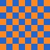

# BLMD User Guide

**BLMD** lets you write notes in Markdown inside Blender: type in the built-in Text Editor and see a formatted preview next to it, updated as you type. Checkboxes in the preview can be clicked, and links can open web pages or control Blender directly, such as switching workspaces, framing objects, or jumping to a node.

> This guide is displayed with BLMD itself. Open it in a preview and click along as you read to try every feature.

---

## 1. Opening the Preview

| How | Shortcut | Result |
|:--|:-:|:--|
| Split button in the Text Editor header | Ctrl+Alt+V | Splits the area; the right side becomes the preview |
| Eye button in the Text Editor header | Ctrl+Shift+V | Toggles the same area between editing and preview |
| **Edit** button in the preview header | Ctrl+Shift+V | Switches back to the Text Editor |

- The preview header has a **text selector** just like the Text Editor: browse other notes, create a new one, or open a .md file from disk. The X on the right only clears the preview; it does not delete the text.
- Blender's own Open does not list .md files (it doesn't treat them as text). Use **Text > Open Markdown** at the bottom of the Text Editor's Text menu, or the folder button in the preview header.
- Each preview remembers which note it shows, across workspace switches and after saving and reopening the file.
- If the screen already has a preview of the same note, Ctrl+Alt+V does not open a second one.

## 2. Using the Preview

| Action | Effect |
|:--|:--|
| Mouse wheel | Scroll up and down |
| Page Up / Page Down | Scroll one page |
| Home / End | Jump to the top or bottom |
| Click a checkbox | Check or uncheck it; undo with Ctrl+Z |
| Click a link | Open a web page or control Blender (see section 4) |
| Hover a checkbox or link | The cursor turns into a pointing hand |

Clicking regular text or empty space does nothing.

---

## 3. Supported Syntax

Type on the left, and the right side **updates live**. Line breaks are kept as written; you don't need a blank line between lines.

### 3.1 Headings

```
# Heading 1
## Heading 2
### Heading 3
```

Level 1 and level 2 headings get a divider line underneath.

### 3.2 Text Styles

Regular text, **bold**, *italic*, ~~strikethrough~~, `inline code`.

```
**bold**  *italic*  ~~strikethrough~~  `inline code`  \*escaped\*
```

- Italic text is drawn upright (Blender's text drawing has no italic font).
- Underscores inside words are not treated as italic, e.g. snake_case_name.
- Put a backslash in front of a symbol to show it as is: \*not italic\*.

Long lines wrap automatically: The quick brown fox jumps over the lazy dog. Words are never split, and CJK text such as 中文可以在任何字之間斷開 can break between any two characters.

### 3.3 Lists

- First item
- Second item
  - Sub-item (indent with two spaces)
    - One level deeper
1. Numbered list
2. Second step
3. Third step

### 3.4 Checkboxes (clicking edits the source)

- [x] Something done
- [ ] Something to do
  - [ ] Sub-tasks are clickable too

```
- [ ] To do
- [x] Done
```

### 3.5 Tables

| Shot | Animation | Lighting | Notes |
|:--|:-:|:-:|--:|
| S01 | [x] | [x] | Done |
| S02 | [x] | [ ] | Waiting for lighting |
| S03 | [ ] | [ ] | Not started; this cell is longer and wraps when the preview gets narrow |

- In the second row, `:--`, `:-:` and `--:` mean left, center and right alignment.
- A cell that starts with `[ ]` or `[x]` becomes a clickable checkbox. This is a BLMD extension; on GitHub it shows as plain text.
- Write `\|` to put a `|` character inside a cell.
- When a table is too wide, column widths are distributed by content and cell text wraps.

### 3.6 Quotes and Horizontal Rules

> Quoted text is dimmed, with a line on the left.
> It can span several lines.

Above is a quote; below is a horizontal rule (`---`).

---

### 3.7 Code Blocks

```python
import bpy

for ob in bpy.context.selected_objects:
    print(ob.name)  # indentation is kept
```

Wrap code in three backticks. It is shown in a monospaced font, and long lines wrap.

### 3.8 Images

An image must be **on a line of its own**; an image written in the middle of a sentence only shows its description.

```
            image on disk
    // means relative to the .blend
     image inside the .blend
```


A missing image shows a placeholder:


- Relative paths are resolved from the note's file location. For a note stored inside the .blend, they are resolved from the folder containing the .blend.
- Images wider than the preview are scaled down to fit.
- Images from the web are not supported.

---

## 4. Links

### 4.1 Web Links

- Regular link: [Blender website](https://www.blender.org)
- A pasted URL becomes a link too: https://docs.blender.org/manual/
- Links open in your default browser. Long links that wrap are clickable on every line.

```
[link text](https://address)
```

### 4.2 Blender Links

Start the address with `bl:` and clicking it controls Blender directly. Names must match Blender **exactly**; spaces are allowed.

| Syntax | What happens |
|:--|:--|
| `bl:workspace/name` | Switch to the workspace |
| `bl:object/name` | Select the object and frame it in the 3D Viewport (it fills about half the view) |
| `bl:collection/name` | Select all objects in the collection and frame them |
| `bl:camera/name` | Make it the scene camera and look through it; the selection is not changed |
| `bl:local/name` | Local View (Numpad /) showing only this object; click again to exit |
| `bl:frame/number` | Jump to the frame on the timeline |
| `bl:node/tree/node` | Jump to the node or frame in the Node Editor |
| `bl:text/note name` | Show another note in the preview |

**Try it** (using the contents of Blender's default new file):

- Objects: [Cube](bl:object/Cube), [Camera](bl:object/Camera)
- Collection: [Collection](bl:collection/Collection)
- Camera view: [Camera](bl:camera/Camera)
- Local View: [Cube only](bl:local/Cube) (click again to exit)
- Frames: [frame 1](bl:frame/1), [frame 120](bl:frame/120), [frame 250](bl:frame/250)
- Node: [World Background](bl:node/World/Background) (the window needs a Shader Editor)
- Workspaces: [Layout](bl:workspace/Layout), [Shading](bl:workspace/Shading) (names follow your interface language)

### 4.3 Node Jump Details

- **Node tree**: searched among materials, node groups and worlds, in that order.
- **Node**: matched by internal name first, then by the label you set. **Frames count as nodes**, so the frame label is the easiest to use, e.g. `bl:node/MyMaterial/Lighting Setup`.
- Leave out the node to show the whole node tree.
- The Node Editor switches the way Blender normally does, without pinning:
  - Material: switches to that material's slot on the selected object; if the selected object doesn't use it, an object that does is selected instead.
  - Geometry Nodes: selects the object that uses the node group as a modifier.
  - World: only the world used by the current scene.
- Only when none of the above works (a material no object uses, a node group nested inside another tree) is the Node Editor pinned instead.

### 4.4 Scope and Safety

- Objects, collections and cameras are looked up in the **current scene**; the 3D Viewport and Node Editor are looked up in the **window containing the preview**. If nothing is found, a message appears at the bottom left.
- `bl:` links can only perform the fixed actions in the table above and **cannot run arbitrary operators or Python**. Notes are stored inside the .blend, so a .blend file someone else gives you cannot use its notes to do anything harmful.

### 4.5 Linking Notes Together

Use `bl:text/` to build a table of contents or link notes to each other, for example:

```
[Back to contents](bl:text/Contents.md)
```

---

## 5. Limitations and Notes

- **Italic**: drawn upright.
- **Images on disk**: loaded as Blender image data. Since nothing uses them, they are not saved into the .blend.
- **Preview area**: it is actually an Info editor. Switching back to editing restores the normal Info editor settings.

---

## 6. Shortcuts

| Where | Shortcut | Action |
|:--|:--|:--|
| Text Editor | Ctrl+Shift+V | Switch to preview |
| Text Editor | Ctrl+Alt+V | Open a preview to the side |
| Preview | Ctrl+Shift+V | Back to editing |
| Preview | Wheel, Page Up/Down, Home/End | Scroll |
| Preview | Left click | Click checkboxes and links |
